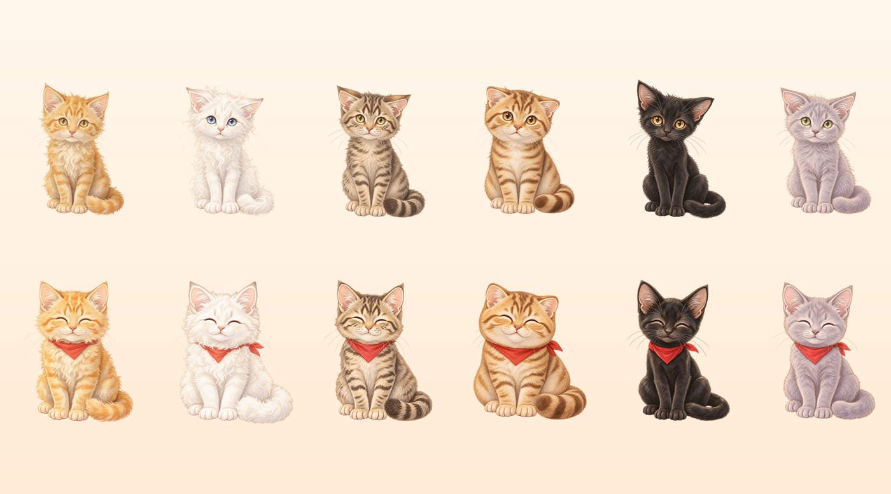

# 🐱 麦麦猫屋 McdCat Haven

> **用你的一餐，换流浪猫的一餐。**
> 一个基于麦当劳 MCP 的领养流浪猫公益养成 H5 —— 2026 麦当劳程序员创意开发大赛参赛作品。

🔗 **仓库**：https://github.com/3kcloud/mcdcat-haven
🎮 **在线体验**：https://mcdcat-haven.app.workbuddy.host/

> 如果这个项目让你觉得「有点意思」，欢迎点个 ⭐ ——
> 这是让更多流浪猫的故事被看见，最直接的方式。

<p align="center">
  
  <br/><sub>上排 · 相遇（瘦弱警惕）→ 下排 · 新家（戴上红领巾，找到家）</sub>
</p>

---

## 一、它在讲什么

城市里有无数只「小橘」「奶昔」「芝麻」——它们在后巷的纸箱里、垃圾桶旁、空调外机上长大，
没有名字，也没有人等它们回家。

**麦麦猫屋**把麦当劳的订单数据变成了一件温柔的事：
你在麦当劳的每一笔消费，会按 **¥1 = 10g** 换算成「爱心猫粮」，用来喂养一只你领养的流浪猫。
投喂满 20 次后，它会走完 *相遇 → 熟悉 → 信赖 → 新家* 四个阶段，
最后**戴上红领巾，被领养**，并生成一张属于你们的领养证书。

> 💛 这不是一个「养电子宠物」的游戏，而是一次关于「领养代替购买」的轻声倡导。

---

## 二、玩法

| 环节 | 说明 |
|---|---|
| **领养** | 从 6 只麦当劳特色流浪猫中选一只（每只有真实感的流浪身世） |
| **获取猫粮** | A 麦门主食（真实订单金额换算）/ B 爱心任务（签到 + 浏览菜单·营养·活动）/ 演示模式 |
| **投喂** | 每 100g 猫粮 = 1 次投喂，每阶段需 5 次 |
| **成长** | 4 个阶段，猫咪立绘随之变化（瘦弱警惕 → 圆润微笑 → 红领巾新家） |
| **结局** | 走完 4 阶段 = 找到家，出具领养证书分享图 |

### 6 只猫

| 猫 | 麦当劳特色 | 流浪身世 |
|---|---|---|
| **小橘** | 薯条 | 后巷被雨水泡软的纸箱里，瘦得能看见肋骨 |
| **奶昔** | 麦旋风 | 冬天蜷在空调外机旁取暖的小奶猫 |
| **芝麻** | 巨无霸 | 快餐店后巷垃圾桶旁长大 |
| **团子** | 麦乐鸡 | 被弃养时瘦骨嶙峋，蜷起来像冷掉的饭团 |
| **玄米** | 可乐 | 一身乌黑，因曾被伤害而极度怕人 |
| **芋圆** | 香芋派 | 流浪猫妈妈留下的孩子 |

### 爱心等级与称号（8 级）

拾粮人 → 投喂实习生 → 麦麦饲养员 → 暖爪管理员 → 爱心站长 → 猫屋主理人 → 麦门守护者 → 流浪猫之友（隐藏）

> 只展示**等级与称号**，不展示消费金额 —— 成就感保留，攀比压力去掉。

---

## 三、真实调用了麦当劳 MCP 哪些能力

| 玩法环节 | MCP Tool | 数据层 |
|---|---|---|
| 订单金额 → 猫粮换算 | `order-list` | 个人（玩家授权） |
| 菜单 / 爱心餐素材 | `query-meals` | 公开 |
| 营养数据 | `list-nutrition-foods` | 公开 |
| 一键领券（里程碑奖励） | `auto-bind-coupons` | 个人（玩家授权） |

📄 完整调用说明、真实返回结构与验证记录见 **[MCP_INTEGRATION.md](./MCP_INTEGRATION.md)**。

已真机验证：服务端 `mcd-mcp` 1.0.0，35 个 tools 可用，上述能力全部调通（含真实领券）。

---

## 四、合规与公益声明（重要）

本项目严格遵守大赛内容规范与公益伦理：

- 🌱 **猫粮是「喂养量」，不是「喂人类食品」**：绝不出现「喂猫吃薯条/汉堡」的意象。
  页面明示：*现实中请勿随意投喂人类食品给猫咪，科学喂养请咨询兽医。*
- 🚫 **不承诺任何捐赠**：爱心猫粮为**游戏内虚拟数值**，不代表任何真实捐赠或实物兑换。
- 🐾 **猫咪为虚构角色**，旨在倡导「领养代替购买」「科学喂养 · TNR」。
- 📊 **不展示热量/卡路里数字**，营养仅作正向表述，规避不健康饮食导向。
- 🔒 **隐私**：MCP Token 仅存于服务端环境变量；个人订单数据仅读取金额，不落库、不上送第三方。
- ⭐ **合规边界**：所有游戏奖励均由**游戏成就**解锁，与 GitHub Star 完全脱钩。

---

## 五、技术栈与结构

- **前端**：Vite + TypeScript（DOM/CSS 动画 · `html2canvas` 分享图 · `localStorage` 存档）
- **后端**：Vercel Serverless（`api/mcp-order.js`）作 MCP 代理层
  —— 浏览器无法直连 `mcp.mcd.cn`（CORS），故代理层必须存在

```
.
├── index.html
├── src/
│   ├── data.ts     # 6 猫档案 · 四阶段 · 称号 · 配置
│   ├── logic.ts    # 状态 · 猫粮换算 · 投喂成长
│   ├── ui.ts       # 首页 / 详情 / 证书渲染
│   ├── share.ts    # html2canvas 分享图
│   └── main.ts     # 路由与事件
├── api/mcp-order.js        # MCP 代理（order-list → 金额）
├── public/assets/cats/     # 6 猫 × 4 阶段 = 24 张立绘（真透明 PNG）
├── MCP_INTEGRATION.md      # MCP 真实调用说明
├── mcp-config.example.json # MCP 配置示例（脱敏）
└── workbuddy.md            # WorkBuddy 开发说明
```

## 六、在线试玩

🎮 **https://mcdcat-haven.app.workbuddy.host/**

打开即玩，无需登录。未配置 MCP Token 时以**演示模式**运行（预置模拟订单），完整可玩；
填入自己的 MCP Token 即可解锁**真实订单 → 猫粮换算**。

> 未配置 MCP Token 时，游戏以**演示模式**运行（预置模拟订单），完整可玩。

## 七、本地运行

```bash
npm install
npm run dev      # http://localhost:5173
npm run build    # 产物在 dist/
```

> 未配置 MCP Token 时，游戏以**演示模式**运行（预置模拟订单），完整可玩。

---

© 2026 · 本项目为参赛作品，猫咪角色与故事均为虚构，旨在公益倡导。
麦当劳相关商标归其权利人所有。
